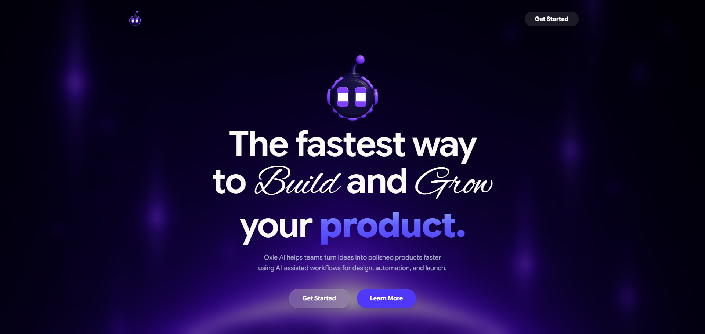
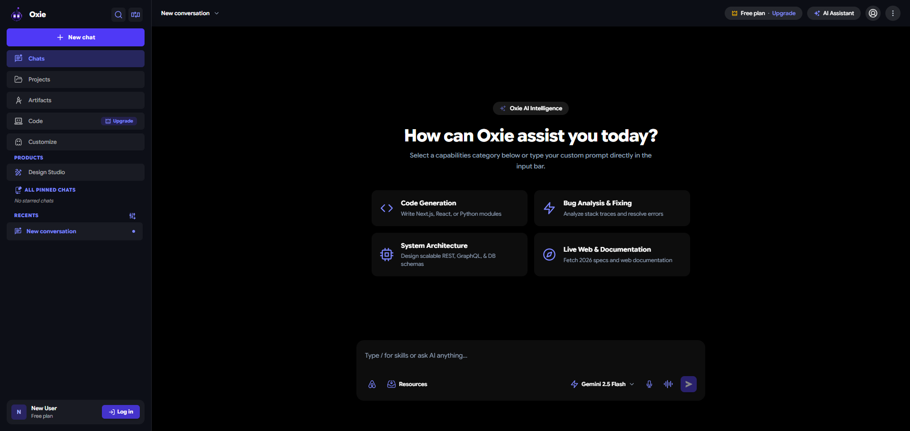

# 🚀 Oxie AI Assistant — Capstone Project

Welcome to **Oxie AI Assistant**, a state-of-the-art AI application built with **Next.js 16 (App Router)**, **Vercel AI SDK**, **Tailwind CSS**, **Google Gemini API streaming**, and a custom **3D Glassmorphism Design System**.

---

## 🌟 Live Preview & Testing URLs

- **Homepage Landing:** [http://localhost:3000](http://localhost:3000)
- **AI Chat Experience:** [http://localhost:3000/chat](http://localhost:3000/chat)

---

## 📸 UI Showcase

### 1. Landing Homepage


### 2. Interactive AI Chat Experience


---

## ⚡ How to Test Failure States & Features in the Web UI

We have built robust error handling and streaming capabilities into `http://localhost:3000/chat`:

### 1. ⚡ Normal (200) — Happy Path
- **Action:** Visit `http://localhost:3000/chat`, select a prompt or type a question (e.g. *"Design a clean RESTful API endpoint..."*), and click Send.
- **Result:** Response streams token-by-token in a dark glass card with code syntax highlighting, copy, like, dislike, and timestamp actions.

### 2. ⚡ 429 Rate Limit
- **Action:** Exceed model quotas or trigger rate limit errors on `/api/chat`.
- **Result:** Displays a styled error banner with clear rate-limit feedback and a functional **Retry** action.

### 3. ⚡ Mid-Stream Interruptions
- **Action:** Interrupt network connectivity during active response generation.
- **Result:** Streams initial tokens before interrupting cleanly with an inline error notification. Partial stream content is safely preserved.

### 4. ⚡ 500 Server Error
- **Action:** Trigger invalid API key or server-side exception parameters.
- **Result:** Displays an error banner with graceful error boundary fallback and **Retry** button.

### 5. ⚡ Smooth Latency & Zero Layout Shift
- **Action:** Send prompts requiring multi-step processing or web search logic.
- **Result:** Displays animated thinking indicators without layout shift (CLS = 0).

---

## 🎨 Theme & Typography Design System

- **Dark Glass Engine**: Deep dark indigo background (`#0d0f17`) with backdrop blur filters and soft 3D rim reflections (`shadow-[inset_0_1px_1px_rgba(255,255,255,0.35)]`).
- **Typography Standard**:
  - **Body & UI Font**: `Google Sans Flex` (`--font-sans`).
  - **Cursive Accents**: `Alex Brush` (`--font-cursive`) for hero headlines (`Build` and `Grow`).
- **Text Palette Standard**:
  - **Primary Headings & Content:** Pure `text-white` (`#ffffff`).
  - **Subtext & Muted Labels:** `text-white/60` (60% white opacity).
  - **Indigo Highlights**: `text-indigo-400` & `bg-indigo-600/30`.
  - **Zero Gray Text**: All gray variants replaced with white opacity standards for consistent dark mode contrast.

---

## 📦 Tech Stack

- **Framework:** Next.js 16.2.12 (Turbopack, App Router)
- **AI Engine:** Vercel AI SDK (`ai`), `@google/genai` (Google Gemini 2.5 Flash)
- **Icons:** React Icons (`bi`, `fi`, `md`, `pi`, `tb`, `vsc`, `gr`, `lu`, `fa`, `hi2`)
- **Favicon & Brand Assets:** Oxie logo icon (`/favicon.ico`, `/icon.png`, `/images/oxie.png`)
- **Styling:** Custom Glassmorphism, Tailwind CSS v4, Framer Motion

---

## 🚀 Quickstart & Setup

### 1. Installation

```bash
git clone https://github.com/CoderGUY47/-Capstone-FL-Agent-Oxie.git
cd -Capstone-FL-Agent-Oxie
npm install
```

### 2. Environment Setup

Create `.env.local` in root:

```env
GEMINI_API_KEY=your_gemini_api_key_here
```

### 3. Development Server

```bash
npm run dev
```

Visit [http://localhost:3000](http://localhost:3000).

### 4. Production Build

```bash
npm run build
npm run start
```

---

## 🤝 Author & Repository

- **Author:** [CoderGUY47](https://github.com/CoderGUY47)
- **Repository:** [https://github.com/CoderGUY47/-Capstone-FL-Agent-Oxie](https://github.com/CoderGUY47/-Capstone-FL-Agent-Oxie)
